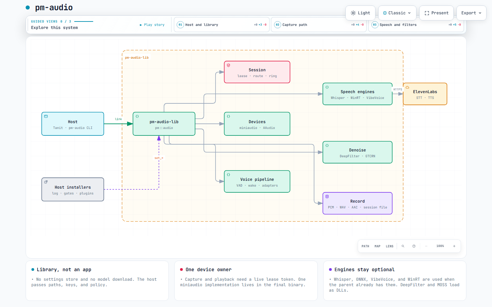
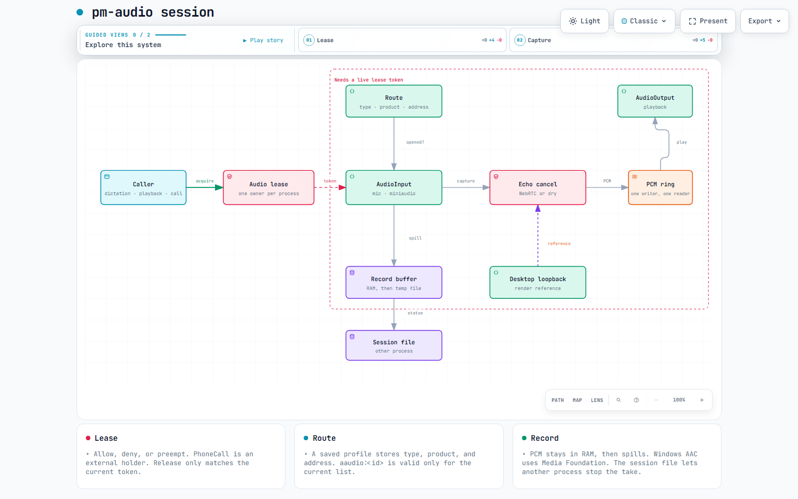
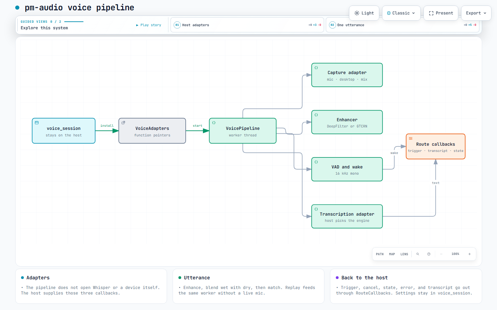
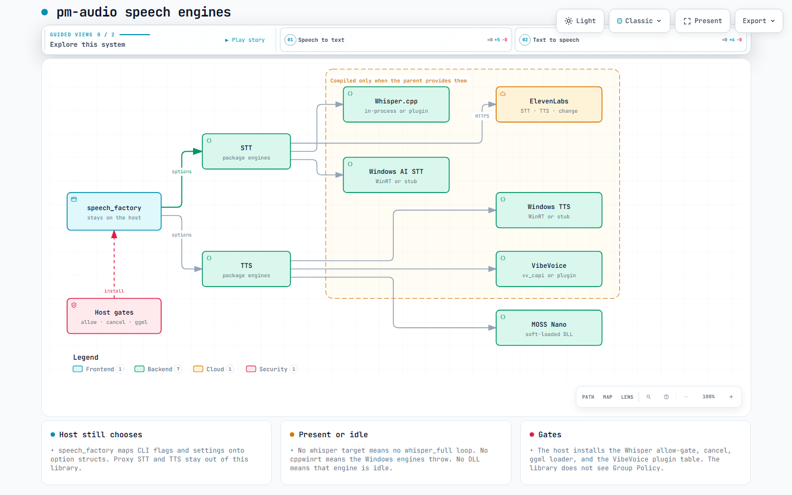

# pm-audio


General purpose C++20 audio library for capture, playback, speech to text, text to speech, pattern recognition, and offline helpers. 

The static library is `pm-audio-lib`, namespace `pm::audio`, public headers under `include/pm/audio/`. A top-level build also produces the `pm-audio` test CLI.

The library does not store settings and does not download models. Optional engines (Whisper.cpp, ONNX Runtime, VibeVoice, DeepFilterNet, MOSS) are used when a parent build already provides them, or when you point this package at those trees.

## Architecture

Interactive copies are in [docs/architecture](docs/architecture/architecture.md).

The host links `pm-audio-lib` and installs the hooks this library cannot see (log, allow-gates, plugin tables, echo cancellation). ElevenLabs is the engine that leaves the machine.



One lease per process. Capture and playback refuse to start without the current token. A route stores a device descriptor, not a raw id. Mic PCM stays dry unless the host installed a WebRTC backend.



`voice_session` stays on the host. It fills capture, enhancement, and transcription function pointers. The pipeline resamples an utterance to 16 kHz mono, enhances it, matches a wake word, then transcribes.



`speech_factory` stays on the host. Whisper and VibeVoice compile in only when the parent already has them. Windows speech needs C++/WinRT. MOSS Nano is a DLL.



## Features

- PCM ring, session lease, route, level graph, and a small self-test.
- Microphone, desktop loopback, and playback through miniaudio, plus device enumeration. Echo cancellation is a shell: the host installs a WebRTC backend, or capture stays dry.
- A PCM record buffer (RAM, then spill to a temp file), WAV writing, peak and RMS levels, and a cross-process record session file. AAC-LC encoding uses Media Foundation on Windows. The host supplies the config directory and the CLI executable used by the detached toggle.
- Voice activity, wake-word matching, utterance replay, and a voice pipeline worker.
- Subtitle cues (SRT, VTT, SBV).
- ElevenLabs speech-to-text, text-to-speech, voice change, and a voice-over timeline.
- Markdown and plain-text preparation for speech (md4c).
- PCM sound trigger and a double-whistle detector. The ridge rules, the training profile, and the recorded takes are in [docs/audio-patterns.md](docs/audio-patterns.md).
- File decode, DeepFilterNet, and GTCRN. DeepFilterNet and MOSS Nano are soft-loaded DLLs. GTCRN soft-loads `onnxruntime.dll` on Windows.
- WAV read and write, language codes, and ggml Whisper model lookup. Whisper.cpp inference is compiled in when a `whisper` target already exists and the plugin DLL is off.
- VibeVoice in-process when a `vibevoice` target already exists. A plugin build installs `load` / `unload` / `tts` instead.
- Windows TTS and Windows AI speech when C++/WinRT headers are on the include path (`PM_AUDIO_HAS_WINRT`). Other builds keep a stub that throws.
- AAudio capture on Android. Desktop builds compile a stub.

## Dependencies

Always fetched when the target is missing:

| library | pin | used for |
| --- | --- | --- |
| nlohmann/json | v3.11.3 | public types and the CLI |
| miniaudio | 0.11.21 | devices and file decode |

Fetched only for a standalone build, or when the parent turns the option on:

| library | pin | option | used for |
| --- | --- | --- | --- |
| curl | 8.12.1 | `PM_AUDIO_SPEECH_CLIENTS` | ElevenLabs clients and voice-over |
| pffft | `b3344191` | `PM_AUDIO_SOUND_TRIGGER` | sound trigger |
| md4c | release-0.5.2 | standalone, if no `md4c` target | markdown speech |
| CLI11 | v2.4.2 | the `pm-audio` executable only | CLI |

Not fetched. Supply them, or leave the feature idle:

| component | how this package sees it |
| --- | --- |
| Whisper.cpp | existing `whisper` target, or `PM_AUDIO_WHISPER_ROOT` |
| ONNX Runtime | existing `onnxruntime_imported`, or `PM_AUDIO_ONNX_ROOT` / `third_party/onnxruntime-*` |
| VibeVoice | existing `vibevoice` target |
| DeepFilterNet, MOSS Nano | DLLs found at runtime |
| C++/WinRT | `PM_AUDIO_HAS_WINRT` plus the Windows SDK include |
| WebRTC APM | host calls `set_apm_backend` |

A parent build defaults `PM_AUDIO_SPEECH_CLIENTS`, `PM_AUDIO_SOUND_TRIGGER`, and `PM_AUDIO_FILTER` to off, so a small host does not fetch curl or pffft. A standalone build defaults them to on.

`MINIAUDIO_IMPLEMENTATION` belongs in one translation unit of the final binary. The static library only calls `ma_*`. The `pm-audio` executable and the Android `pm_image_jni` library compile `src/miniaudio_impl.cpp`. Desktop already compiles `src/core/audio_devices.cpp` and must not add a second one.

## Build

From this directory:

```text
npm run configure
npm run build:cpp
npm test
```

`scripts/cmake.mjs` runs CMake. On Windows it loads the Visual Studio environment so Ninja can find `cl`. `npm run build:cpp-fast` runs Ninja in the existing build directory and does not reconfigure. CMake itself can be overridden with `CMAKE`.

The binary is `build/dev/pm-audio.exe` on Windows and `build/dev/pm-audio` elsewhere. Tests honor `PM_AUDIO_CLI`.

```text
pm-audio selftest
pm-audio match --text "hey tanit what time" --wake tanit
pm-audio subs --format srt --out clip.srt --text "hello" --t0 0 --t1 1200
pm-audio decode --src in.wav --dst out.wav --rate 16000
pm-audio speak --text "# Hello"
pm-audio voice
pm-audio record --dst clip.wav
pm-audio sound-trigger inspect take.wav --json
pm-audio sound-trigger match take.wav
pm-audio sound-trigger train --id clap --json --samples take1.wav ... take8.wav --ambient room.wav --out clap.json
pm-audio sound-trigger test
pm-audio devices
pm-audio runtimes
```

`sound-trigger inspect` prints `pm.sound.inspect/v1`. `match` prints `pm.sound.trigger/v1` and exits 0, or `pm.sound.no-match/v1` and exits 2. A training take that fails the quality checks prints the reason on stderr and exits 2. `test` listens on the default microphone until Ctrl+C. `--source desktop` uses loopback. A camera-plus-mic mix stays on the host command.

Success is one JSON object on stdout and exit 0. Failure is `{"ok":false,"error","code","status"}` and exit 1. A usage error exits 2.

## Example setup

```cmake
set(PM_AUDIO_SPEECH_CLIENTS ON CACHE BOOL "" FORCE)
set(PM_AUDIO_SOUND_TRIGGER ON CACHE BOOL "" FORCE)
set(PM_AUDIO_FILTER ON CACHE BOOL "" FORCE)

if(NOT TARGET pm-audio-lib)
  add_subdirectory(packages/audio.cpp
                   ${CMAKE_CURRENT_BINARY_DIR}/pm-audio-lib
                   EXCLUDE_FROM_ALL)
endif()
target_link_libraries(my_app PRIVATE pm-audio-lib)
```

Include `pm/audio/...`. Do not compile `cli/` into the host. Pass model paths, API keys, and policy checks in. Hooks cover the cases the library cannot see: a log sink (`pm::audio::log`), an ONNX or Whisper allow-gate, a ggml backend loader, plugin function tables, and the echo-cancellation backend.

```cmake
set(PM_AUDIO_WHISPER_ROOT "/opt/whisper.cpp" CACHE PATH "" FORCE)
set(PM_AUDIO_ONNX_ROOT "/opt/onnxruntime" CACHE PATH "" FORCE)
```

`PM_AUDIO_TANIT_ROOT` is the tree searched for `third_party/onnxruntime-*` and the DeepFilterNet and GTCRN model folders when those paths are not set. `pm-audio runtimes` prints the roots it resolved.

## Refernences

- [ASR-Commands - aka "Voice Commands"](./docs/asr-commands.md)
- [Audio filters](./docs/audio-next-filters.md)
- [Feature extraction, pattern matching (Ridge)](./docs/audio-patterns.md)
- [Android Handsfree implementation notes](./docs/handsfree-android.md)
